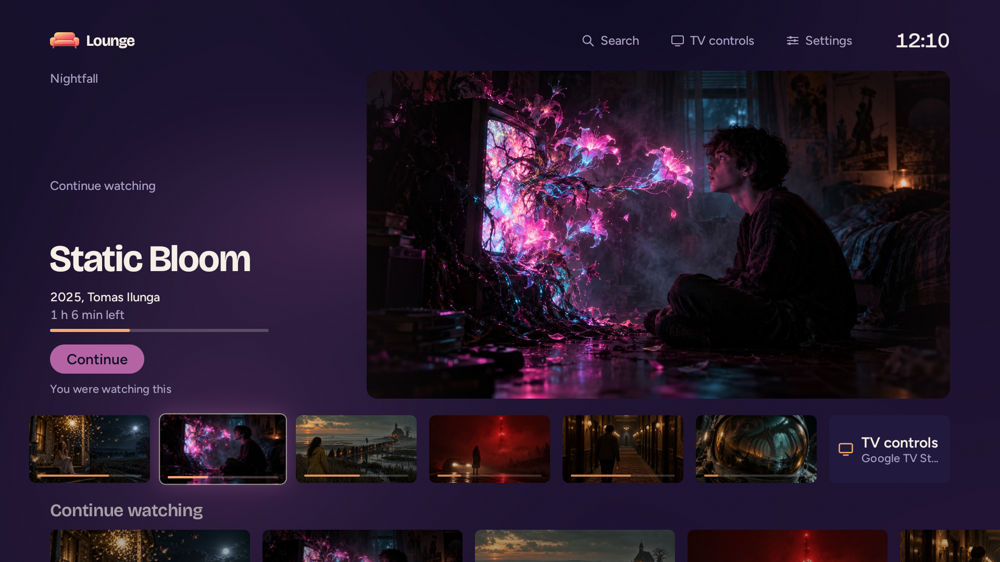
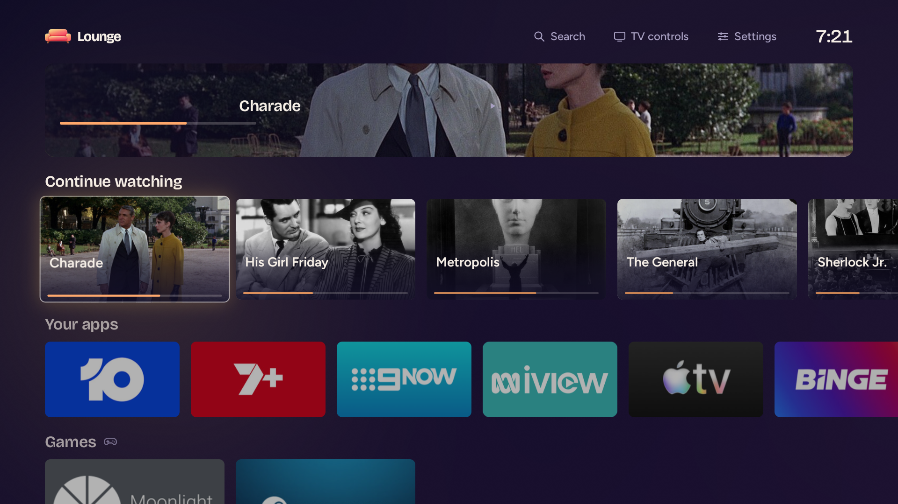
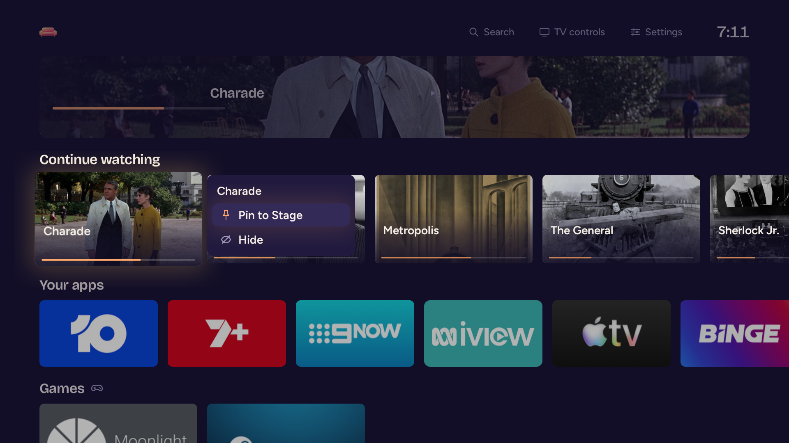
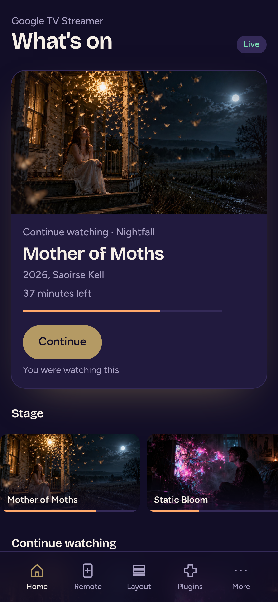
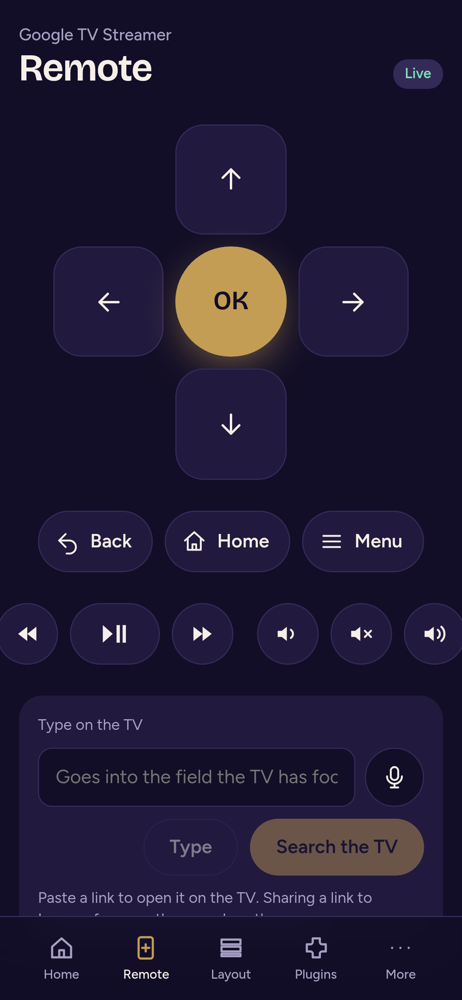
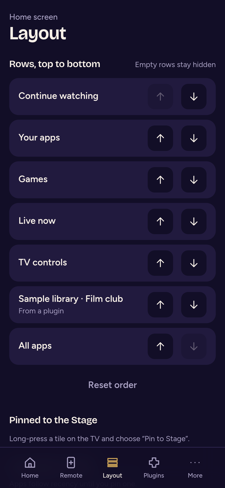
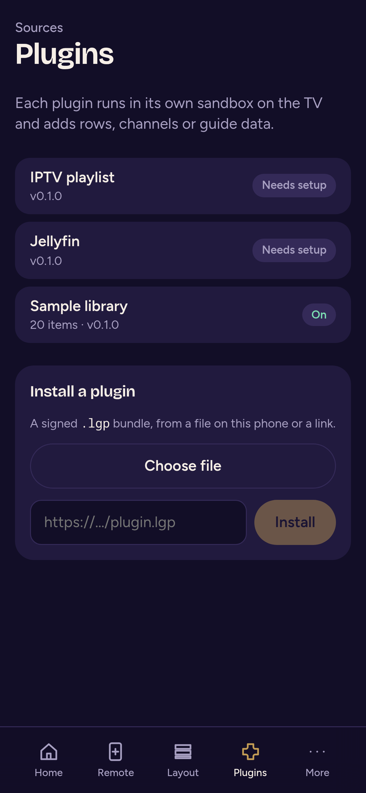
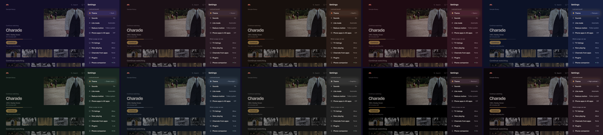
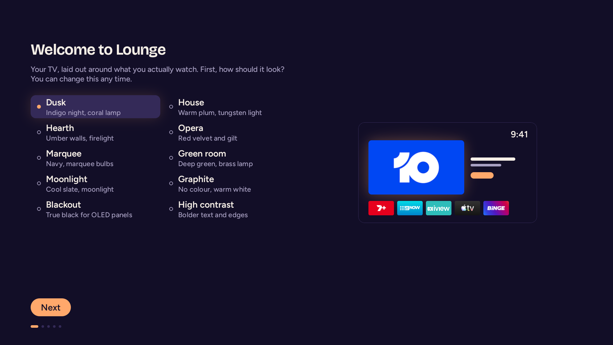
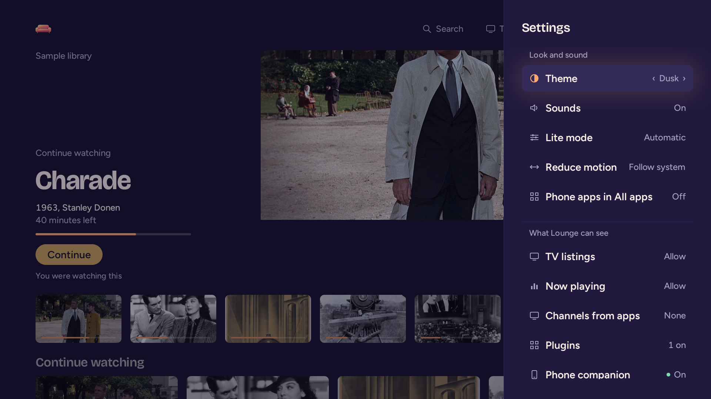

<p align="center">
  
</p>

<h1 align="center">Lounge</h1>

<p align="center">
  A free, open-source launcher for Android TV and Google TV, laid out around what you're watching.<br>
  Quick on the remote, calm to look at, and nothing leaves the house.
</p>

<p align="center">
  <a href="../../releases/latest"></a>
  <a href="../../actions/workflows/check.yml"></a>
  
  <a href="LICENSE"></a>
</p>

<p align="center">
  <a href="../../releases/latest"></a>
</p>

<p align="center"><sub>One APK, no account. Copy it to a USB stick, open it on the TV, and you're about five minutes from a new home screen. <a href="#installing-on-a-tv">Full steps</a>.</sub></p>

<p align="center">
  
</p>

## At a glance

<table>
<tr>
<td width="33%" valign="top">
<br>
<b>The Stage</b><br>
The top of the screen shows one thing: the episode you were on, the channel that's live, or the app you usually open at this hour.
</td>
<td width="33%" valign="top">
<br>
<b>The whole TV</b><br>
HDMI inputs named after what's plugged in. On a streamer, the TV's power, input and sound as well.
</td>
<td width="33%" valign="top">
<br>
<b>Your rows</b><br>
Pin, reorder and hide. Your apps in your order, and games in a row of their own.
</td>
</tr>
<tr>
<td width="33%" valign="top">
<br>
<b>Continue watching</b><br>
One list from every app that publishes Watch Next, the TV's own listings and your media server.
</td>
<td width="33%" valign="top">
<br>
<b>Lit by the artwork</b><br>
The focused tile's colour spills onto the wall behind it. Ten themes, including Blackout and High contrast.
</td>
<td width="33%" valign="top">
<br>
<b>Your phone as a remote</b><br>
A web page the TV serves. It types, rearranges the home screen and installs plugins.
</td>
</tr>
<tr>
<td width="33%" valign="top">
<br>
<b>Live TV and a guide</b><br>
Channels from the tuner and from plugins, with a programme guide.
</td>
<td width="33%" valign="top">
<br>
<b>Screensaver</b><br>
Your artwork or nine abstract scenes, which can also play behind the home screen.
</td>
<td width="33%" valign="top">
<br>
<b>Twenty-three plugins</b><br>
Jellyfin, Plex, Kodi, Stremio, IPTV, Trakt, Twitch and more. Each is sandboxed WebAssembly in a signed bundle.
</td>
</tr>
</table>

<p align="center"><sub>Updates itself from this repository's releases. Android 9 and up, arm64 and 32-bit ARM.</sub></p>

## Why

The home screen that comes with a TV works for the company that made it. It's slow on the
hardware it ships on, it fills the rows with things to buy, it plays trailers you didn't ask
for, and it phones home about all of it. The thing you were in the middle of watching is in
there somewhere.

Lounge starts from that thing: one picture, the title, how much is left, and a button. Under it
are rows you arrange yourself. It reads what the apps on the TV already publish, what your media
server knows and what you tell it, and it keeps all of that on the TV.

## What it does

**The Stage.** The top of the screen shows one thing at a time, with a strip of the next few
under it. No single app gets more than half of those places while another has something to
continue. Move down into the rows and the Stage shrinks to a band with the title still on it;
move back up and it opens again.

**Rows.** Continue watching draws on every app that publishes Watch Next, the TV's own listings
and plugins. Your apps holds the apps you pin, in your order, then the five you opened last
(Settings changes that to ten, fifteen or none). Games get a row of their own, marked when a
controller is connected. Settings, Rows lists every row the home could show: OK shows or hides
one, and holding OK picks it up to move. Empty rows stay off the screen. The same sheet lists
every app and plugin that Continue watching draws on, with how many titles each brings. All of
them are shown unless you hide one.

Streaming apps such as Netflix only appear in Continue watching if they publish Watch Next
entries Lounge is allowed to read, so turn on TV listings in Settings.
[TV listings troubleshooting](docs/TV_LISTINGS.md) shows how to check what an app publishes.

**The hold-OK menu.** Hold OK on any tile to pin it to the Stage, hide it, or hide its whole
row. An app can also be pinned to the front of Your apps and moved, and gets app info, the store
page and uninstall. On something in Continue watching you can hide everything from its app,
which keeps that app out of the row and off the Stage until you show it again in Settings, Rows.

**All apps.** The last tile in Your apps opens every app on the TV as one grid, sorted A to Z,
by last opened or by when it was installed. An alphabet down the side jumps through it, and
typing a name on the remote or the phone narrows it.

**Live TV.** Channels from the tuner and from plugins show what's on now, and a guide lays the
schedule out by channel and time.

**The TV itself.** HDMI inputs carry the names their devices announce over CEC and show whether
anything is plugged in. On a streamer, a TV controls card turns the TV on, switches input, sends
sound to a soundbar, changes the volume or turns everything off.

**Now playing.** Music or a podcast playing in the background gets a chip in the top bar and a
card with play, pause and skip.

**Search.** One box for apps, what you've been watching and whatever the plugins can find.

**Screensaver.** Artwork from the Stage and the rows with a slow push-in, or one of nine abstract
scenes drawn on the GPU in your theme's colours. Plugins can add scenes
([PLUGINS.md](PLUGINS.md#screensavers)), and any scene can also run behind the home screen,
dimmed so the tiles stay the brightest thing in the room.

**Setup.** Five screens on first run: the look, what to allow, making it the home screen, pairing
a phone, done. All of it is in Settings afterwards.

<p align="center">
  
  
</p>

## The phone

Settings, Phone companion shows a QR code and a six-digit code. The phone companion is a web page
at `http://<tv>:8787` that works in any browser on the same network, and a shortcut to it can go
on the phone's home screen. It is not an app to install: the TV serves it itself, with no
account, and remembers the phone until you forget it. A code or QR code pairs one phone, and
the TV shows a fresh one as soon as it is used.

<p align="center">
  
  &nbsp;
  
  &nbsp;
  
  &nbsp;
  
</p>

- **What's on** mirrors the home screen. Tap a tile to open it on the TV, or hold it for the
  same menu as the remote's.
- **Remote** has a d-pad, Back, Home, Menu and the media keys, a field that types into Lounge's
  search and other fields, and a place to paste a link that opens on the TV. Home, the volume and
  the media keys work whatever is on screen. The d-pad, OK, Back and Menu reach another app only
  while Power Setup is connected; without it they work in Lounge alone.
- **Layout** shows, hides and reorders rows, pins and orders the apps at the front of Your apps,
  unpins things from the Stage, shows or hides each source of Continue watching, and brings back
  anything you hid.
- **Plugins** sets up the installed plugins and installs new ones from a file or a link.
- **More** backs up your layout and settings to one file and restores it, asking first before a
  restore replaces anything, lists the paired phones with when each was last seen, and shows the
  TV's diagnostics.

## Plugins

A plugin is a WebAssembly module in a signed `.lgp` bundle. It runs inside the core under a fuel
budget and a memory cap, and it can't touch Android, the file system, sockets or other plugins.
All it can do is fetch from the hosts its manifest names, keep a small private store, read its
settings and log. What it publishes becomes tiles, Stage spotlights, channels in the guide or
rows of its own.

The TV pins each publisher's key when you install a plugin and refuses an update signed by
anyone else. Plugins built into the APK are vouched for by the APK itself. Any language that
targets core WebAssembly will do: the interface is eight imports and six exports with JSON in
between.

Twenty-three ship in the APK, written against the same SDK as anyone else's. Turn on the ones you
use from the phone or the TV's settings. One that needs a sign-in shows a code and a QR code on
its page, and carries on by itself once you have entered the code on your phone. If an app such as Plex or Jellyfin is on the TV and its
plugin is off, the home offers to set it up until you do or dismiss the offer.

| Plugin | What it adds |
|---|---|
| Jellyfin | Resume points and next episodes in Continue watching, recently added and favourites as rows, and search. Opens in the Jellyfin app. Sign in with Quick Connect or a username and password. |
| Emby | The same from an Emby server. Tiles open the Emby app. |
| Plex | On Deck in Continue watching, recently added as a row, and search. Sign in with a code at plex.tv/link or paste a token. |
| Kodi | Resume points in Continue watching, up next and new additions as rows, and Live TV, from a Kodi library, played on whichever Kodi you choose. |
| Trakt | What you paused in Continue watching, and what's next and your watchlist as rows, wherever you watch it. |
| Simkl | What you paused, what's next, what you plan to watch and what airs this week, for shows, anime and films. |
| Stremio | Paused titles, next episodes and newly released episodes in Continue watching, the library as a row, and search. Opens in the Stremio app. |
| Nuvio | Paused titles and next episodes in Continue watching, the library as a row, and search. Opens in the Nuvio TV app. |
| Sonarr and Radarr | This week's episodes and releases, what's downloading and what just arrived. Tiles search for the title in whichever app has it. |
| Spotify | Recently played, playlists, saved albums and podcasts with a Spotify developer app, or any Spotify links you paste without one. Opens in the Spotify app. |
| IPTV | An M3U playlist as channels, with a guide from XMLTV. |
| HDHomeRun | The tuner's channels and guide, played in the TV's own player. |
| Tvheadend, Channels DVR, NextPVR | A DVR's channels and guide, with its recordings as a row. |
| Twitch | The live channels you follow, in Live now and the guide. |
| YouTube | New videos from channels and playlists through their public feeds. With a Google sign-in, your subscriptions, playlists and liked videos too. |
| Podcasts | New episodes from feeds, Apple Podcasts links or an OPML export, played in a player app. Search uses Apple's directory. |
| Moonlight | Your gaming PCs and their games from Sunshine, as tiles that start a stream in Moonlight. A game left running shows up in Continue watching. |
| Internet Archive | Free films, cartoons and television from archive.org, with search. |
| Immich photos | A shared Immich album as the screensaver. |
| Art mode | Public-domain paintings from the Met and the Cleveland Museum of Art as the screensaver. |
| Weather | The temperature and sky now and each day's high for the week ahead in a town you name, as a row of small tiles to read. Celsius or Fahrenheit. From Open-Meteo, with no account or key. |

A twenty-fourth, **Sample library**, lives in the repository but not the APK: eighteen
public-domain films with their posters, so you can see Lounge with something on it. The pictures
in this file show a made-up horror library instead; every title, poster and name in them is
invented.

[PLUGINS.md](PLUGINS.md) takes you from nothing to a plugin on your TV. Submissions are welcome:
open a pull request that adds yours under `plugins/` once it passes the
[checklist](PLUGINS.md#checklist-before-you-share-it).

## The look

The idea is a dim living room at night with one bright thing in it. The backdrop is dark and the
focused tile is the lamp: its artwork's colour spills onto the wall around it, and after a
minute without the remote the lights go down. Ten themes change the walls and the lamp and
nothing else.

<p align="center">
  
</p>

The type is Bricolage Grotesque and Figtree, both bundled. Reduced motion follows the system
setting or your own, and Lite mode turns off the shader and the colour spill for a TV that
struggles with them. The whole design system is written down in [DESIGN.md](DESIGN.md).

<p align="center">
  
  
</p>

## Installing on a TV

Download `Lounge-<version>.apk` from the [Releases](../../releases) page, or build it yourself
(below). It runs on Android TV and Google TV from Android 9.

### With a USB stick

1. Copy the APK onto a USB stick and plug it into the TV.
2. Open the APK with a file manager on the TV. Google TV has none built in, but any from the
   Play Store will do. The first time, Android asks you to let that file manager install apps.
3. Open Lounge. Its setup makes it the home screen through **Power Setup**: when it asks, turn
   on USB debugging in Developer options, then choose Allow on the TV's prompt and tick Always
   allow. USB debugging stays on afterwards: the TV controls and the phone's keys in other apps
   need it, and Power Setup says what stops working if you turn it off.

No USB stick? Install **Downloader** from the Play Store, open
`github.com/Gingerbreadfork/lounge/releases` in it, choose the APK, and carry on from step 3.

### With ADB

With USB debugging on and a computer on the same network, this installs Lounge and makes it
the home screen; press Home and its setup starts:

```sh
adb connect <tv>:5555
adb install -r Lounge-<version>.apk
adb shell cmd package set-home-activity tv.lounge.launcher/.MainActivity
```

On Google TV the stock home and its setup app outrank any home you choose, so switch them off
too. They stay installed, and `pm enable` with the same names brings them back; do that before
you uninstall Lounge, or the TV is left without a home screen.

```sh
adb shell pm disable-user --user 0 com.google.android.apps.tv.launcherx
adb shell pm disable-user --user 0 com.google.android.tungsten.setupwraith
```

Power Setup does all of this from the TV as well, and can undo it, including the faster
animations it offers. It also grants the optional
permissions, drives the TV over HDMI-CEC, sets the screensaver and compiles Lounge ahead of
time. It shows each command before running it.

### Updates

Lounge checks the [Releases](../../releases) page twice a day, verifies a newer APK against its
published hash and installs it while you're in another app. Each release carries a profile, and
where Android accepts it the update is compiled as it installs, so it is quick from its first
start. From Android 12 there is no prompt after the first update, and with Power Setup there is
none at all; otherwise a tile on the home screen offers it. On Google TV, Play Protect may warn the
first time that it doesn't know the developer: choose More details, then Install anyway. Settings,
Updates turns the check off if you'd rather manage updates yourself, for example with
[Obtainium](https://github.com/ImranR98/Obtainium) pointed at this repository.

## How it's built

The shell is Kotlin and Compose for TV. Everything that decides what to show is a Rust core
behind a UniFFI boundary: a graph of apps, programmes, channels and inputs with their usage,
ranking into the Stage and the rows, a SQLite store, and an artwork pipeline that decodes each
picture once and writes every size the screen needs. Plugins run in
[wasmi](https://github.com/wasmi-labs/wasmi) inside that core. The companion is an
[axum](https://github.com/tokio-rs/axum) server in the same process, with the Svelte 5 app
embedded at build time, about 30 KB gzipped.

The APK is 24 MB. On a Google TV Streamer the release build is on screen in about a second
from a cold start, sits a little over 100 MB, and keeps the main thread under 5 ms on nine
frames out of ten while you move around. A TCL television with a Mali GPU runs the same build
at about 75 MB and is bound by its GPU rather than its CPU. Both are measured with the scripts
in `tools/`.

Lounge itself fetches the artwork the TV's other apps publish and checks GitHub twice a day for
updates. Plugins reach only the hosts their manifests name, and only once you turn them on.
There are no accounts and no analytics.

## Building from source

You need JDK 21, the Android SDK with platform 37 and NDK 27, stable Rust with `cargo-ndk` and
the `wasm32-unknown-unknown` target, cmake, a C compiler and zlib's headers for the bundled
image libraries, and Node 24 with pnpm 10.

```sh
rustup target add wasm32-unknown-unknown aarch64-linux-android armv7-linux-androideabi
cargo install cargo-ndk
(cd companion && pnpm install)
tools/plugins/build.sh                      # bundles and signs the built-in plugins into app assets
cd android && ./gradlew :app:assembleRelease
```

Gradle runs the Rust and web builds itself: it compiles the core for both ABIs with cargo-ndk,
generates the Kotlin bindings, and builds the companion with pnpm when `node_modules` is
present. The plugin publisher key is created on first use at `~/.config/lounge/publisher.key`
and never enters the tree.

There are three build types: `debug` installs beside a release as `tv.lounge.launcher.debug`,
`release` is shrunk with R8 and carries a baseline profile, and `profile` exists only to capture
that profile with `tools/baseline-profile.sh`. Release builds are signed with the debug key
unless `lounge.storeFile`, `lounge.storePassword`, `lounge.keyAlias` and `lounge.keyPassword`
are set in `~/.gradle/gradle.properties`.

Every push builds and tests the whole thing on GitHub and keeps the APK as an artifact named
`lounge-apk-debug-signed`. It is signed with the debug key, so no release can update it once
installed. Pushing a tag publishes a release; [docs/RELEASING.md](docs/RELEASING.md) has the
rules and the secrets it needs.

## Working on it

```sh
cd companion && pnpm install && pnpm build   # once: the core embeds the phone app and needs it built
cd core && cargo test --workspace            # the core: graph, ranking, colour, store, artwork, plugins
cd plugins && cargo test --workspace         # the SDK and the built-in plugins
cd android && ./gradlew :power:testDebugUnitTest
cd companion && pnpm exec svelte-check
cd companion && LOUNGE_TV=http://<tv>:8787 pnpm dev    # the phone app against a real TV
```

On a device, `tools/drive.sh <serial> <out dir>` walks a fixed path through the launcher and
saves a screenshot after every step, `tools/framestats.sh <serial>` prints per-phase frame times
for that path, and `tools/baseline-profile.sh <serial>` captures a fresh baseline profile from
the `profile` build. The scripts compile the installed build the way a real install ends up, so
frame times mean something.

```
android/     Gradle project: app, core/{bindings,design,platform}, collector/*, feature/home, power
core/        Rust workspace: lounge-core (UniFFI), -graph, -store, -artwork, -plugins, -companion
plugins/     Rust workspace: the plugin SDK, the built-in plugins, lgp-tool
companion/   Svelte 5 phone app, embedded into the core at build time
design/      fonts, the mark's sources and renderer, the sound renderer
docs/        the pictures in this file, and how to release
tools/       device drives, frame timing, the baseline profile, builds, the README's icons
workdir/     ignored by git: your own notes, logs and measurements
```

[DESIGN.md](DESIGN.md) is the design system every screen follows. [PLUGINS.md](PLUGINS.md) is
for writing a plugin.

## License

[MIT](LICENSE). The bundled fonts are under the SIL Open Font License; see `design/fonts/`.
