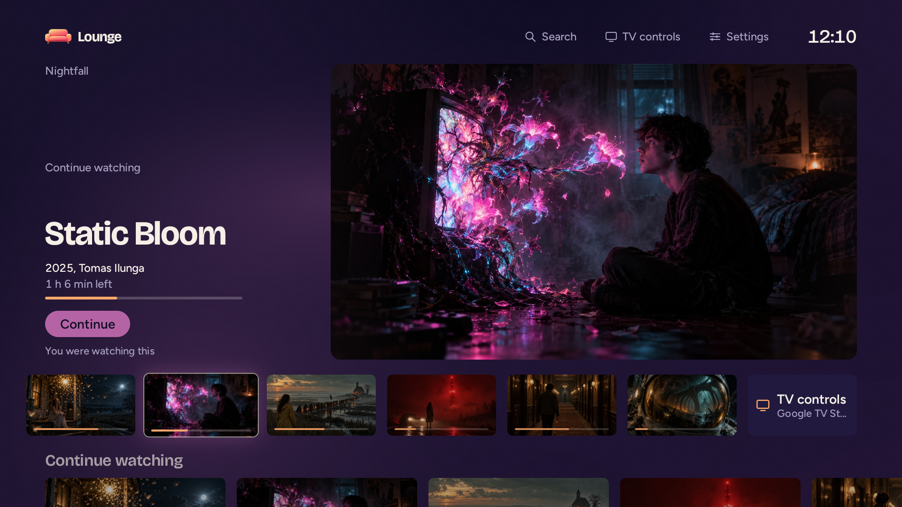
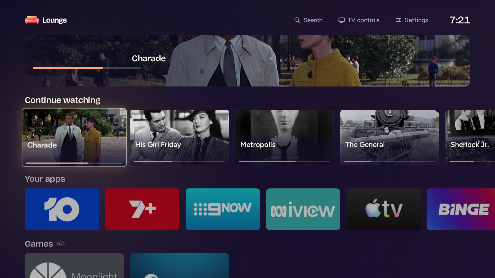
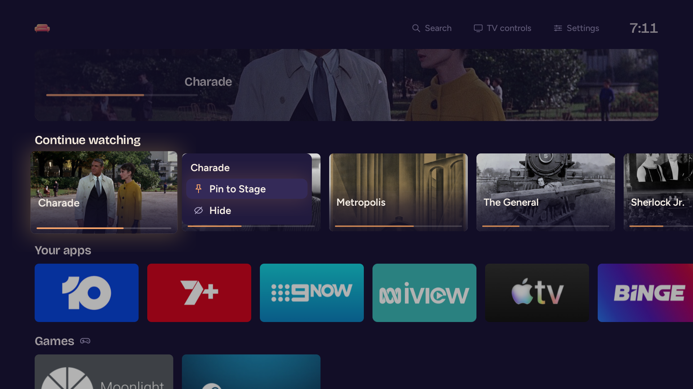
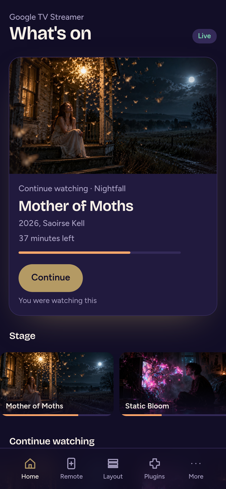
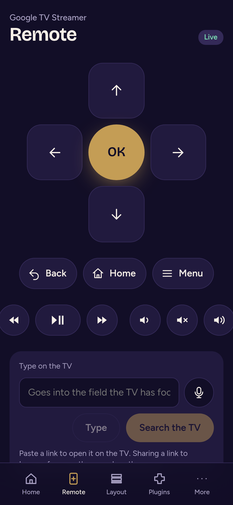
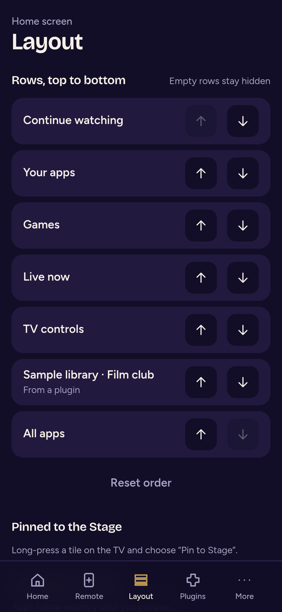
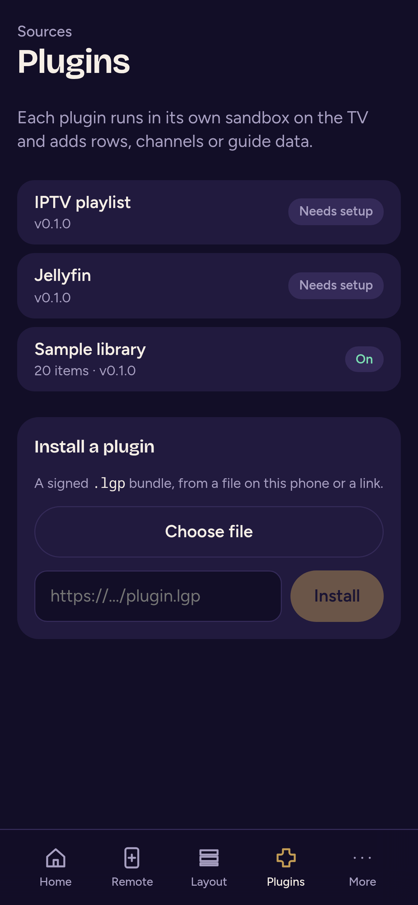
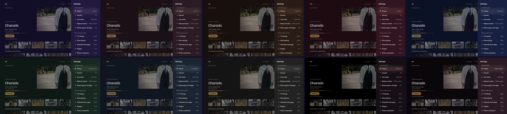
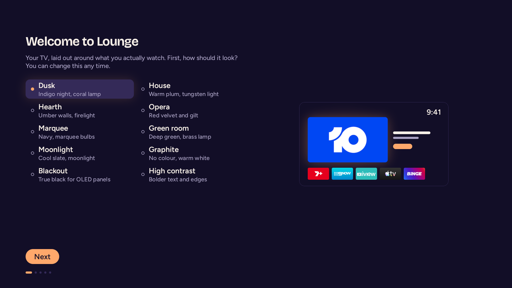
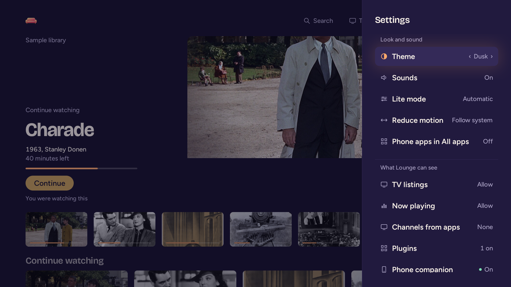

<p align="center">
  
</p>

<h1 align="center">Lounge</h1>

<p align="center">
  A home screen for Android TV and Google TV, laid out around what you actually watch.<br>
  Quick on the remote, calm to look at, and nothing leaves the house.
</p>

<p align="center">
  
</p>

## Why

The home screen that comes with a TV works for the company that made it. It is slow on the
hardware it ships on, it fills the rows with things to buy, it plays trailers you did not ask
for, and it phones home about all of it. The thing you were in the middle of watching is in
there somewhere.

Lounge starts from that thing. One picture, the title, how much is left, and a button. Under it,
rows you arrange yourself: what you are watching, your apps in your order, live channels with a
guide, the inputs on the back of the TV. It reads what the apps on the TV already publish, what
your media server knows, and what you tell it, and it keeps all of that on the TV.

## What it does

**The Stage.** The top of the screen is given to one thing at a time: the episode to continue,
the channel that is on, the app you open every evening at this hour. A strip under it holds the
next few. Move down into the rows and the Stage lowers to a band with the title still on it;
move back up and it rises again, one continuous picture, nothing squeezed.

**Rows you own.** Continue watching comes from every app that publishes it, from the TV's own
listings, and from plugins. Your apps sit in the order you pin them, sorted by how recently you
opened them until you do. Games get a row of their own, marked when a controller is connected.
All apps is the whole list. Hold OK on any tile for a menu: pin, move, hide, pin it to the Stage, app info, the store
page, uninstall. Rows with nothing in them stay out of the way.

**Live TV with a guide.** Channels from the TV's tuner and from plugins show what is on now, and
a guide lays the schedule out as a grid of channels and time.

**The TV itself.** HDMI inputs with the names their devices announce over CEC and whether
anything is plugged in. On a streamer, a TV controls card turns the TV on and switches to the
right input, sends sound to a soundbar, changes the volume, or turns everything off.

**Now playing.** Music or a podcast playing in the background shows as a chip in the top bar and
a card with play, pause and skip.

**Search.** Apps, what you have been watching, and whatever the plugins can find, from one box.
When it is empty it shows what you watched recently.

**Set up once.** Five screens on first run: how it should look, which accesses to allow, making
it the home screen, pairing a phone, done. Every one is reachable again from Settings.

<p align="center">
  
  
</p>

## The phone

Settings, Phone companion shows a QR code and a six-digit code. The page at
`http://<tv>:8787` works in any browser on the same network and can be added to the phone's
home screen like an app. The TV serves it itself and remembers the phone until you forget it.

<p align="center">
  
  &nbsp;
  
  &nbsp;
  
  &nbsp;
  
</p>

- **What's on** mirrors the home screen. Tap a tile and it opens on the TV.
- **Remote** is a d-pad, Back, Home, Menu and the media keys, a field that types into whatever
  the TV has focused, voice through the phone's own recogniser, and a place to paste a link that
  opens on the TV. Sharing a link to Lounge from any other app does the same.
- **Layout** reorders the rows and your pinned apps, and shows what is pinned to the Stage.
- **Plugins** configures the installed plugins and installs new ones from a file or a link.
- **More** downloads a backup of your layout and settings as one JSON file and restores it,
  lists the paired phones, and shows the TV's diagnostics.

## Plugins

A plugin is a WebAssembly module in a signed `.lgp` bundle. It runs inside the core under a fuel
budget and a memory cap, with no access to Android, the file system, sockets or other plugins:
the only things it can do are fetch from the hosts its manifest names, keep a small private
store, read its settings, and log. What it publishes becomes tiles, Stage spotlights, channels in
the guide, or rows of its own. Its settings become fields on the TV and on the phone.

Two ship in the APK, written against the same SDK as anyone else's: **Jellyfin** puts your
server's resume points into Continue watching and its newest additions into a row, and answers
search; **IPTV** turns an M3U playlist into channels in Live now and the guide, with programme
information from an XMLTV feed. A third, **Sample library**, lives in the repository but not
the APK: eighteen public-domain films with their posters, a few left part-watched, so you can
see Lounge with something on it. The pictures in this file use it. [PLUGINS.md](PLUGINS.md)
takes you from nothing to a plugin on your TV and covers the whole interface.

## The look

The idea is a dim living room at night with one bright thing in it. The backdrop is dark velvet;
the focused tile is the lamp. Its artwork's own colour spills onto the wall behind it and glows
around it, the tiles beside it lift as if lit from the side, and the rest of the room sits back.
Leave the remote alone for a minute and the lights go down.

Ten themes change the colour of the walls and the lamp and nothing else. Dusk, the default, is
indigo with a coral lamp. House is warm plum under tungsten. Then Hearth, Opera, Marquee,
Green room, Moonlight and Graphite, plus Blackout for OLED panels and High contrast.

<p align="center">
  
</p>

Type is Bricolage Grotesque for headings and Figtree for everything else, both bundled. The three
sounds, for moving, opening and going back, are rendered from a script rather than sampled: felt
and wood in a quiet room, nothing clicky. The mark is a plush coral sofa. Reduced motion follows
the system or your choice, High contrast adds a focus ring, and Lite mode turns the shader and
the spill off for a TV that needs it. The whole system is written down in
[DESIGN.md](DESIGN.md), and the code follows it.

<p align="center">
  
  
</p>

## Installing on a TV

There are no packaged releases yet, so build the APK (below) and install it over ADB. Lounge
runs on Android TV and Google TV from Android 9, on arm64 and 32-bit ARM.

```sh
adb connect <tv>:5555
adb install -r android/app/build/outputs/apk/release/app-release.apk
adb shell am start -n tv.lounge.launcher/.MainActivity
```

The first launch runs the five setup steps. Android does not let an app make itself the home
screen, so that step needs either one command from a computer,

```sh
adb shell cmd package set-home-activity tv.lounge.launcher/.MainActivity
```

or **Power Setup** on the TV (Settings, Power Setup, Connect). Power Setup talks to the TV's own
debugging service after you allow it once on screen, and from then on it can take the home role,
grant the optional accesses, drive the TV over HDMI-CEC from a streamer, set the screensaver and
compile Lounge ahead of time. Every action shows its command before it runs. Nothing it can do is
hidden from you, and the two that change the living room, taking the home role and switching
the TV's power, only ever happen when you press them.

The screensaver is Lounge's own: the artwork from the Stage and the rows, a slow push-in, the
clock, and a line naming the picture.

## Under the hood

The shell is Kotlin and Compose for TV. Everything that decides what to show is a Rust core
behind a UniFFI boundary: a graph of apps, programmes, channels and inputs with their usage,
ranking into the Stage and the rows, a SQLite store, and an artwork pipeline that decodes each
picture once and writes every size the screen needs, including the hero's vignette and the band
the Stage lowers onto. Plugins run in [wasmi](https://github.com/wasmi-labs/wasmi) inside that
core. The companion is an [axum](https://github.com/tokio-rs/axum) server in the same process,
with the Svelte 5 app embedded at build time, about 30 KB gzipped.

The APK is 19 MB. On a Google TV Streamer the release build is on screen in about a second
from a cold start, sits a little over 100 MB, and keeps the main thread under 5 ms on nine
frames out of ten while you move around. A TCL television with a Mali GPU runs the same build
at about 75 MB and is bound by its GPU rather than its CPU. Both are measured with the scripts
in `tools/`, on release builds compiled the way a real install ends up.

Nothing in Lounge talks to the network unless you gave it an address: a media server, a
playlist, a plugin you installed. There are no accounts, no analytics and no update checks.

## Where it is

Version 0.1.0, in daily use on a Google TV Streamer and a TCL television. The Stage, rows, live
TV, inputs, search, the phone, plugins, Power Setup, the screensaver and the setup steps all
work on real data. Still ahead: a place to find other people's plugins, profiles and a kids
mode, remapping remote buttons, and Android 16 picture profiles. The Now playing card has had
less time with music apps than with everything else, and the Google TV Streamer's startup is
still being measured properly. If something is off, open an issue with the TV and its Android
version.

## Building from source

You need JDK 21, the Android SDK with platform 37 and NDK 27, stable Rust with `cargo-ndk` and
the `wasm32-unknown-unknown` target, and Node 24 with pnpm 10.

```sh
rustup target add wasm32-unknown-unknown aarch64-linux-android armv7-linux-androideabi
cargo install cargo-ndk
(cd companion && pnpm install)
tools/plugins/build.sh                      # bundles and signs the two plugins into app assets
cd android && ./gradlew :app:assembleRelease
```

Gradle runs the Rust and web builds itself: it compiles the core for both ABIs with cargo-ndk,
generates the Kotlin bindings, and builds the companion with pnpm when `node_modules` is
present. The plugin publisher key is created on first use at `~/.config/lounge/publisher.key`
and never enters the tree.

There are three build types. `debug` installs beside a release as `tv.lounge.launcher.debug`.
`release` is shrunk with R8 and carries the baseline profile, so the hot paths are compiled
before the first run. `profile` is release without R8 and exists only to capture that profile
with `tools/baseline-profile.sh`. Release builds are signed with the debug key unless
`lounge.storeFile`, `lounge.storePassword`, `lounge.keyAlias` and `lounge.keyPassword` are set
in `~/.gradle/gradle.properties`.

Every push builds the whole thing on GitHub: the core's tests, the plugins and the SDK with
the wasm build, the companion, and the release APK, which each run keeps as an artifact named
`lounge-apk`.

### Releasing

Pushing a tag like `v0.2.0` builds the APK and attaches it to a GitHub release as
`Lounge-0.2.0.apk` with a `SHA256SUMS` file. The tag should match `versionName` in
`android/app/build.gradle.kts`. Two kinds of secret make the release real: the app's signing
key as `LOUNGE_KEYSTORE_BASE64` (the keystore, base64 encoded) with `LOUNGE_KEYSTORE_PASSWORD`,
`LOUNGE_KEY_ALIAS` and `LOUNGE_KEY_PASSWORD`, and the plugin publisher key as
`LOUNGE_PUBLISHER_KEY` (the contents of `~/.config/lounge/publisher.key`). Without the first
the APK is signed with the debug key, which a signed install will not update from; without the
second the bundled plugins are signed with a throwaway key that TVs would pin, so set it before
the first release. `gh secret set LOUNGE_PUBLISHER_KEY < ~/.config/lounge/publisher.key` stores
it.

## Working on it

```sh
cd core && cargo test --workspace            # the core: graph, ranking, colour, store, artwork, plugins
cd plugins && cargo test --workspace         # the SDK and the two plugins
cd android && ./gradlew :power:testDebugUnitTest
cd companion && pnpm exec svelte-check
cd companion && LOUNGE_TV=http://<tv>:8787 pnpm dev    # the phone app against a real TV
```

On a device, `tools/drive.sh <serial> <out dir>` walks a fixed path through the launcher and
saves a screenshot after every step, `tools/framestats.sh <serial>` prints per-phase frame times
for that path from `dumpsys gfxinfo`, and `tools/baseline-profile.sh <serial>` captures a fresh
baseline profile from the `profile` build. Frame times are only meaningful once the installed
build has been compiled the way a real install ends up, which the scripts do for you.

```
android/     Gradle project: app, core/{bindings,design,platform}, collector/*, feature/home, power
core/        Rust workspace: lounge-core (UniFFI), -graph, -store, -artwork, -plugins, -companion
plugins/     Rust workspace: the plugin SDK, the IPTV and Jellyfin plugins, lgp-tool
companion/   Svelte 5 phone app, embedded into the core at build time
design/      fonts, the mark's sources and renderer, the sound renderer
docs/        the pictures in this file
tools/       device drives, frame timing, the baseline profile, plugin and companion builds
workdir/     ignored by git: your own notes, logs and measurements
```

[DESIGN.md](DESIGN.md) is the design system every screen follows. [PLUGINS.md](PLUGINS.md) is
for writing a plugin.

## License

[MIT](LICENSE). The bundled fonts are under the SIL Open Font License; see `design/fonts/`.
